# Takasha Ecosystem — Fabric Mod Suite for Minecraft Java Edition

<p align="center">
  
</p>

<p align="center">
  <b>Ekosistem Mod Fabric Multi-Module Terpadu untuk Minecraft Java Edition: Sistem Manekin Sinematik, Otomasi Bertingkat (Kaizen & Vanilla), Mesin RPG Tanpa Spigot (AuraSkills & AdvancedEnchantments), dan Dungeon Rift Arena.</b>
</p>

<p align="center">
  
  
  
  
  
  
</p>

---

## 📑 Daftar Isi

- [1. Ringkasan Ekosistem & Arsitektur Mod](#1-ringkasan-ekosistem--arsitektur-mod)
- [2. Modul 1: Takasha Core (`sakura-weapons`)](#2-modul-1-takasha-core-sakura-weapons)
  - [2.1 Entitas Manekin Sinematik & 32 Preset Pose](#21-entitas-manekin-sinematik--32-preset-pose)
  - [2.2 Artikulasi Sendi Luwes (Bendable Cuboids) & Outer Layer Sync](#22-artikulasi-sendi-luwes-bendable-cuboids--outer-layer-sync)
  - [2.3 Dynamic Skin Loader Asinkron & Proteksi SSRF](#23-dynamic-skin-loader-asinkron--proteksi-ssrf)
  - [2.4 Replay Studio (F7/P), Flashback Panel & Zero-Desync Protocol](#24-replay-studio-f7p-flashback-panel--zero-desync-protocol)
  - [2.5 Katalog Anvil Cerdas (Smart Side-List 5-Tab Catalog)](#25-katalog-anvil-cerdas-smart-side-list-5-tab-catalog)
  - [2.6 Master Dashboard & Mesin Otomasi (Kaizen vs Vanilla)](#26-master-dashboard--mesin-otomasi-kaizen-vs-vanilla)
  - [2.7 Mesin Pertanian Pintar (Crop Plot Memory & Zero-Hole Replant)](#27-mesin-pertanian-pintar-crop-plot-memory--zero-hole-replant)
  - [2.8 Server Safe Mode & Standarisasi Zirah Zero-Overlap](#28-server-safe-mode--standarisasi-zirah-zero-overlap)
- [3. Modul 2: Takasha-RPG Singleworld Engine (`takasha-rpg`)](#3-modul-2-takasha-rpg-singleworld-engine-takasha-rpg)
  - [3.1 Sistem Progresi AuraSkills & Skala Atribut Nyata](#31-sistem-progresi-auraskills--skala-atribut-nyata)
  - [3.2 Mesin Custom Enchantment Paritas Penuh (6 Tier, 40+ Enchant)](#32-mesin-custom-enchantment-paritas-penuh-6-tier-40-enchant)
  - [3.3 Item Pendukung: Magic Dust, Scroll, Orb & Buku Misteri](#33-item-pendukung-magic-dust-scroll-orb--buku-misteri)
  - [3.4 Dungeon Rift Arena Engine (5 Tier, Wave Combat & Boss AI)](#34-dungeon-rift-arena-engine-5-tier-wave-combat--boss-ai)
  - [3.5 Boneka Latih Tempur (Damage Dummy) & Status SubGUI DoT](#35-boneka-latih-tempur-damage-dummy--status-subgui-dot)
  - [3.6 Ekonomi Dinamis, Toko Harian Berputar & `/sellgui`](#36-ekonomi-dinamis-toko-harian-berputar--sellgui)
  - [3.7 Event Dunia Berkala & Grimoire 16 Gelar Kedaulatan](#37-event-dunia-berkala--grimoire-16-gelar-kedaulatan)
- [4. Modul 3: Takasha RPG Web Companion (`takasha-rpg-web`)](#4-modul-3-takasha-rpg-web-companion-takasha-rpg-web)
- [5. Struktur Direktori Repositori](#5-struktur-direktori-repositori)
- [6. Panduan Instalasi & Penggunaan](#6-panduan-instalasi--penggunaan)
- [7. Panduan Pengembang & Kompilasi (Build Guide)](#7-panduan-pengembang--kompilasi-build-guide)
- [8. Riwayat Rilis & Semantic Versioning](#8-riwayat-rilis--semantic-versioning)
- [9. Lisensi & Kredit](#9-lisensi--kredit)

---

## 1. Ringkasan Ekosistem & Arsitektur Mod

**Takasha Ecosystem** adalah kumpulan mod Fabric kelas produksi untuk Minecraft Java Edition yang menggabungkan rekayasa grafis tingkat tinggi, sistem gameplay RPG tanpa ketergantungan server Spigot/Paper, modul pendamping hidup, dan utilitas penunjang pembuatan konten/sinematografi:

```mermaid
graph TD
    subgraph "Takasha Unified Ecosystem (v2.8.0)"
        subgraph "1. Takasha Core (sakura-weapons)"
            NPC["Mannequin NPC System<br/>(32 Poses, Bendable, Skin URL, Push Physics)"]
            ANVIL["Smart Anvil Side-List<br/>(5-Tab Catalog, Color Format, Context Filter)"]
            AUTO["Automation Suite<br/>(Kaizen/Vanilla Mob Kill, Fishing, Crop Memory Farm)"]
            REPLAY["Replay & Flashback Studio<br/>(Zero-Desync Protocol, In-Game Keybind F7/P)"]
            SAFE["Server Safe Mode<br/>(Auto Multiplayer Guard, Hotkey Suppression)"]
        end

        subgraph "2. Takasha-RPG Engine (takasha-rpg)"
            AURA["AuraSkills Engine<br/>(7 Skills, Real Stat Modifiers, Actionbar HUD)"]
            ENCHANT["Custom Enchant Engine<br/>(6 Tiers, 40+ Enchants, Dust, Scrolls, Orbs)"]
            DUNGEON["Dungeon Rift Arena<br/>(5 Tiers, Wave Survival, Boss AI, Drops)"]
            DUMMY["Damage Test Dummy<br/>(Floating Numbers, Status SubGUI, DoT DPS)"]
            ECONOMY["Dynamic Economy<br/>(Daily Rotating Shop, Pricing Engine, /sellgui)"]
            SOVEREIGN["Grimoire & Sovereignty<br/>(16 Titles & Traits, Story Quests, Events)"]
        end

        subgraph "3. Web Companion (takasha-rpg-web)"
            WEB["Interactive Web App<br/>(Port 5173, Catalog Browser, Stat Tracker)"]
        end
    end

    subgraph "Minecraft Java Runtime"
        ENGINE_MODERN["Minecraft 26.2 (Java 25 LTS, Unobfuscated)"]
        ENGINE_LEGACY["Minecraft 1.21.11 (Java 21 LTS, Remapped)"]
        FABRIC["Fabric Loader + Fabric API"]
    end

    NPC --> FABRIC
    ANVIL --> FABRIC
    AUTO --> FABRIC
    AURA --> FABRIC
    ENCHANT --> FABRIC
    DUNGEON --> FABRIC
    TLM_CORE --> FABRIC
    FABRIC --> ENGINE_MODERN
    FABRIC --> ENGINE_LEGACY
    AURA -.-> WEB
    ENCHANT -.-> WEB
```



---

## 2. Modul 1: Takasha Core (`sakura-weapons`)

Modul inti yang menyediakan entitas manekin sinematik, katalog anvil interaktif, alat perekaman replay, dan mesin otomasi utilitas.

### 2.1 Entitas Manekin Sinematik & 32 Preset Pose
* **Spawner Item:** `Takasha Mannequin Wand` (terdapat di tab kreatif Sakura Arsenal).
* **Interaksi:**
  - *Shift + Klik Kanan* pada manekin: Membuka antarmuka konfigurasi lengkap `TakashaNpcScreen`.
  - *Klik Kanan Biasa* membawa item/zirah: Langsung memasang perlengkapan ke tangan atau slot armor yang sesuai.
* **32 Katalog Preset Pose:**
  - **Tiduran & Rebahan (1–7):** Tidur Terlentang Kasur (Offset Kasur Y+0.5625), Tidur Tengkurap, Tidur Miring Kanan/Kiri, Rebahan Santai, Tidur Memeluk Senjata, Terkapar KO.
  - **Duduk & Bersimpuh (8–14):** Duduk Kursi, Duduk Bersandar Lantai, Bersila Lotus, Meditasi, Jongkok Siaga, Berlutut Ksatria, Bersimpuh Seiza.
  - **Kuda-kuda Tempur (15–24):** Siaga Berdiri, Siap Bertarung, Cabut Senjata Kilat, Dual Wield Akimbo, Membidik Busur, Kuda-kuda Tombak, Senjata Berat, Perisai, Tusukan Cepat, Tebasan Melompat.
  - **Gestur & Emote Statis (25–32):** Bersedekap, Hormat Ksatria, Membungkuk Sopan, Menunjuk Tegas, Melambai, Berduka, Facepalm, Berpikir Keras.

### 2.2 Artikulasi Sendi Luwes (Bendable Cuboids) & Outer Layer Sync
* **Bendable Cuboids:** Model mannequin mendukung tekukan sendi anatomis pada siku dan lutut sehingga pose duduk bersila, bersimpuh, dan tidur terlihat alami.
* **Outer-Skin Synchronizer (`copyModelPartPose`):** Seluruh layer pakaian luar pemain (`hat`, `jacket`, `leftSleeve`, `rightSleeve`, `leftPants`, `rightPants`) disinkronkan presisi dengan kubus inti untuk mencegah pakaian atau rambut melayang.

### 2.3 Dynamic Skin Loader Asinkron & Proteksi SSRF
* **Input Fleksibel:** Mendukung URL langsung file gambar PNG (`https://...`) atau nama pemain resmi Minecraft.
* **Non-Blocking Thread:** Menggunakan `HttpClient` Java 25 asinkron di background thread agar tidak terjadi frame drop.
* **Zero SSRF Vulnerability:** Server game tidak pernah mengunduh file biner gambar. Server hanya menyimpan string URL/hash, sedangkan setiap klien mengunduh skin ke direktori cache lokal (`.minecraft/takasha_cache/skins/`).

### 2.4 Replay Studio (F7/P), Flashback Panel & Zero-Desync Protocol
* **Zero-Desync Baseline:** Semua 32 preset pose, rotasi Euler, dan status tidur kasur disimpan di dalam `SynchedEntityData` dan direkam ke paket `.mcpr` ReplayMod.
* **Continuous Timeline (`npcState.animTime`):** Saat ReplayMod di-pause (`gameTime == 0`) atau di-scrub, animasi emote dan napas prosedural tetap terputar mulus di layar preview timeline.
* **Studio Replay Viewer (`TakashaReplayOverrideScreen`):** Tekan tombol pintas **`F7`** atau **`P`** kapan saja di dalam replay viewer atau dunia untuk merekonfigurasi pose dan emote manekin seketika.
* **Integrasi Flashback:** Panel kontrol ImGui tersemat langsung pada menu klik entitas Flashback (`SelectedEntityPopup`).

### 2.5 Katalog Anvil Cerdas (Smart Side-List 5-Tab Catalog)
* **5 Tab Kategori:** `[All]`, `[Sakura]`, `[Pink]`, `[Valentine]`, `[Dragon]`.
* **Smart Context Filter:** Memasukkan Pedang di slot input hanya menampilkan senjata bilah; memasukkan Elytra hanya menampilkan sayap; memasukkan Beliung hanya menampilkan beliung.
* **Auto-Fill & Formatting:** Klik kiri mengisi nama item standar; Shift + Klik kiri mengisi format warna dan simbol Minecraft (`§`) tanpa melebihi batas 50 karakter Anvil.

### 2.6 Master Dashboard & Mesin Otomasi (Kaizen vs Vanilla)
Buka menu utama Takasha Dashboard dengan menekan tombol **`K`**:
* **Auto Kill Mob:**
  - **Mode KAIZEN:** Osilasi cerdas anti-AFK, raycast Line-Of-Sight presisi tinggi untuk celah half-slab mob grinder, jeda sinkronisasi cooldown senjata ($\ge 95\%$), dan kerucut pandang anti-aura ($\le 35^\circ$).
  - **Mode VANILLA:** Pure stationary attack tanpa pergerakan otomatis, deteksi jarak instan, unthrottled attack rate (Turbo $\ge 70\%$ atau Hyper Spam 0ms), sudut pandang bebas 360°.
  - **Kontrol Nilai Manual 100%:** Jangkauan (2.5m–6.0m), Prioritas Target (Nearest, Lowest HP, Highest HP, FOV Center), Smart Critical (lompat serang 150% damage), Hostile/PVP filter.
* **Auto Fishing:**
  - **Mode KAIZEN:** Pelacakan paket lonjakan pergerakan pelampung (`ClientboundSetEntityMotionPacket`), integrasi solver Auto-Capcay 1.0, penanganan lepas joran (*Rod Slip Recovery*), dan jitter manusiawi ($\pm 100$ms).
  - **Mode VANILLA:** Deteksi suara percikan air vanilla (`ClientboundSoundPacket`), bypass Capcay/Rod Slip, jeda tarik deterministik.
  - **Kontrol:** Reel-in delay (0ms–300ms), recast delay (250ms–1500ms), sensitivitas gigitan (Ultra/High/Normal), Auto Rod Swap saat durability $\le 3$, Whitelist tangkapan.
* **Auto Bow:** Otomatis membidik dan menembakkan anak panah ke target terdekat.
* **Fortune Reshaper:** Otomatis menukar perkakas tangan ke alat ber-enchantment Fortune/Silk Touch saat memecahkan blok bijih.

### 2.7 Mesin Pertanian Pintar (Crop Plot Memory & Zero-Hole Replant)
Sistem Auto-Farm generasi baru (`TakashaFarmHandler`) menghadirkan **Zero-Hole Guarantee** yang mengimbangi kecepatan panen secara instan dan presisi:
* **Crop Plot Memory Map:** Pemetaan spasial lahan pertanian in-memory selama sesi aktif. Mengenali jenis benih asli per koordinat (`FARMLAND` untuk gandum/wortel/kentang/bit, `SOUL_SAND` untuk nether wart, `JUNGLE_LOGS` untuk kakao).
* **In-Tick Instant Pairing (0ms Delay):** Paket panen dan paket penanaman kembali dikirim secara berpasangan dalam tick yang sama.
* **Symmetric Batch Throughput:** Mendukung hingga 12 aksi per tick.
* **Flow-Control Backpressure:** Otomatis menahan pemanenan jika terdeteksi $\ge 2$ petak tanah kosong terdekat hingga lahan pulih sempurna.
* **Drop-Delay Resilient Backoff Retry:** Melakukan retry hingga 25 siklus ($\times 150$ms) sembari menunggu benih hasil panen tersedot ke inventori pemain.
* **Sticky Offhand Caching:** Mempertahankan benih di tangan kiri tanpa swap bolak-balik berlebih.

### 2.8 Server Safe Mode & Standarisasi Zirah Zero-Overlap
* **Server Safe Mode (`serverSafeMode`):** Mendeteksi koneksi ke server multiplayer publik secara otomatis (`!mc.isLocalServer()`). Menonaktifkan pintasan Replay Studio, tombol edit developer, dan fitur berisiko untuk menjaga keamanan pemain dari tuduhan pelanggaran aturan server.
* **Zero-Overlap Matrix 128x64:** Partisi UV HD terstandarisasi untuk zirah set Sakura, Pink Legacy, Valentine, dan Dragon Mecha Overlord. Menghilangkan bug helm membengkak (*Hat Layer 1.5F bloat*), tabrakan layer celana vs sepatu, dan celah leher bolong.

---

## 3. Modul 2: Takasha-RPG Singleworld Engine (`takasha-rpg`)

Modul mandiri Fabric yang merekonstruksi pengalaman RPG Spigot/Paper kelas atas ke dalam dunia Singleplayer dan Dedicated Server Fabric tanpa memerlukan plugin server eksternal:

### 3.1 Sistem Progresi AuraSkills & Skala Atribut Nyata
* **7 Cabang Keahlian:** `Combat`, `Mining`, `Foraging`, `Farming`, `Fishing`, `Archery`, `Defense`.
* **Kalkulasi Stat Dinamis (`AuraStatModifierEngine`):**
  - **Strength:** Meningkatkan damage serangan melee sebesar persentase nyata.
  - **Health:** Menambahkan hati ekstra ke bar darah pemain secara proporsional.
  - **Wisdom:** Mengalikan perolehan EXP dan efisiensi mana.
  - **Toughness:** Memberikan reduksi damage fisik bertingkat.
  - **Luck:** Meningkatkan peluang drop ganda dan kualitas loot peti.
  - **Agility:** Menambah kecepatan gerak dan peluang menghindar (*dodge*).
* **HUD Actionbar Real-Time:** Menampilkan perolehan EXP, persentase progress, indikator mana, dan efek status aktif secara bilingual.
* **Level-Up Fanfare:** Efek suara dan partikel perayaan saat pemain naik level keahlian.

### 3.2 Mesin Custom Enchantment Paritas Penuh (6 Tier, 40+ Enchant)
Mengadaptasi fungsionalitas plugin legendaris *AdvancedEnchantments* ke Fabric:
* **6 Tier Kelangkaan Terstruktur:**
  - `SIMPLE` (Tier 1) — Putih / Basic
  - `UNIQUE` (Tier 2) — Hijau / Uncommon
  - `ELITE` (Tier 3) — Biru / Rare
  - `ULTIMATE` (Tier 4) — Kuning Emas / Epic
  - `LEGENDARY` (Tier 5) — Oranye / Mythic
  - `SOUL` (Tier 6) — Merah Kirmizi / Transcendent
* **Katalog 40+ Enchantments Aktif:**
  - **Combat Engine (`TakashaEnchantCombatEngine`):** *Lifesteal* (sedot darah musuh), *Bleed* (efek pendarahan DoT), *Shockwave* (gelombang hentakan AoE), *Freeze* (pembekuan gerak musuh), *Execute* (damage mematikan pada HP rendah), *Double Strike* (serangan ganda instan), *Vampire*, *Blindness*, *Poison*, *Divine Light*.
  - **Utility Engine (`TakashaEnchantUtilityEngine`):** *Vein Miner* (penambangan urat bijih 3D DFS sekaligus), *Auto Smelt* (peleburan instan saat menambang), *Telepathy* (drop item langsung masuk ke tas), *Magnet* (penarik drop item dalam radius luas), *Experience Boost*, *Trench* (penggalian area 3x3), *Oxygenate*, *Gears*, *Springs*.
  - **Armor Set Bonus Engine (`ArmorSetBonusHandler`):** Set bonus aktif saat mengenakan 4 potong zirah lengkap bertema.

### 3.3 Item Pendukung: Magic Dust, Scroll, Orb & Buku Misteri
* **Magic Dust (Bubuk Sihir):** Meningkatkan tingkat keberhasilan (*Success Rate*) buku sihir dari 1% hingga 100%. Dibuat dari peleburan buku di Tinkerer.
* **White Scroll (Gulungan Putih):** Melindungi peralatan dari kehancuran jika proses enchant di Anvil mengalami kegagalan (*Destroy Rate*).
* **Black Scroll (Gulungan Hitam):** Mencabut enchant kustom acak dari perlengkapan dan mengubahnya kembali menjadi buku sihir dengan tingkat keberhasilan 100%.
* **Transmutation Orb:** Menambah slot maksimal custom enchant pada senjata atau zirah.
* **Mystery Books:** Buku misteri tersegel yang dapat dibuka dengan klik kanan untuk mendapatkan enchant kustom acak sesuai tier.
* **Sistem Menu Khusus:**
  - `/enchanter` — Toko pembelian buku misteri menggunakan EXP Points murni.
  - `/tinkerer` atau `/tinker` — Antarmuka 54-slot untuk mendaur ulang buku dan armor menjadi Secret Dust.
  - `/alchemist` — Antarmuka 27-slot untuk menggabungkan dua buku bertingkat sama menjadi tingkat yang lebih tinggi.

### 3.4 Dungeon Rift Arena Engine (5 Tier, Wave Combat & Boss AI)
Sistem petualangan dungeon instanced di dalam dunia Minecraft:
* **5 Tier Dungeon Keystones:**
  - Tier 1: Ruin Keystone
  - Tier 2: Crypt Keystone
  - Tier 3: Abyss Keystone
  - Tier 4: Void Keystone
  - Tier 5: Nightmare Keystone
* **Mekanika Pertarungan Gelombang:**
  - Pemain mengaktifkan keystone untuk membuka portal rift.
  - Menghadapi gelombang monster bertahap dengan AI agresif khusus (`DungeonMobHunterGoal`).
  - Fase pertarungan bos dengan mekanika serangan spesial dan batas waktu countdown.
  - Fail-safe permadeath: jika pemain mati di dalam arena, keystone hancur dan arena tertutup.
* **Loot Chest & Material Dungeon:** Peti harta karun interaktif yang berisi drop material crafting eksklusif untuk menempa senjata kustom RPG.

### 3.5 Boneka Latih Tempur (Damage Dummy) & Status SubGUI DoT
* **Entitas Boneka Latih (`DamageDummyEntity`):** Entitas dummy khusus untuk menguji DPS, build enchantment, dan senjata.
* **Floating Damage Numbers:** Angka damage melayang di atas dummy dengan warna dinamis (Kuning = Serangan Normal, Merah = Critical Strike, Ungu = DoT Bleed/Poison, Hijau = Heal).
* **Status SubGUI DoT Tracker:** Menampilkan rincian kalkulasi damage per second (DPS), durasi status efek aktif, dan riwayat serangan secara real-time.

### 3.6 Ekonomi Dinamis, Toko Harian Berputar & `/sellgui`
* **Dynamic Pricing Engine:** Harga komoditas di toko berfluktuasi secara dinamis berdasarkan volume penjualan dan pembelian pemain.
* **Daily Rotating Shop:** Katalog barang dagangan yang berganti otomatis setiap 24 jam (hari game).
* **Perintah `/sellgui`:** Antarmuka cepat untuk menjual massal hasil tani, tambang, dan drop mob dengan perhitungan harga otomatis.

### 3.7 Event Dunia Berkala & Grimoire 16 Gelar Kedaulatan
* **4 Event Dunia Berkala:**
  - `DOUBLE_XP`: Peningkatan perolehan AuraSkills XP 2.0x lipat di seluruh dunia.
  - `MYTHIC_MERCHANT`: Kemunculan pedagang kelana mistis pembawa barang langka.
  - `DUNGEON_RUSH`: Penggandaan loot drop Dungeon Arena 2.0x lipat dan cooldown keystone dihilangkan.
  - `HARVEST_FESTIVAL`: Penggandaan hasil panen pertanian dan foraging 2.0x lipat.
* **Grimoire of Realms (`GrimoireScreen.java`):**
  - Antarmuka 5 tab terstruktur: `[⚔ AuraSkills]`, `[📜 Quests]`, `[👑 Titles]`, `[🌍 Events & Arena]`, `[🏠 Homes]`.
  - Papan quest 4 bab cerita, misi harian/mingguan, dan misi legendaris.
  - **16 Gelar Kedaulatan (G-01 s/d G-16):** Memberikan trait pasif unik (misal: *Adrenaline Surge*, *Void Anchor*, *Lightning Galvanization*, *Phantom Riposte*, hingga *Divine Sovereign*).

---

## 4. Modul 3: Takasha RPG Web Companion (`takasha-rpg-web`)

Aplikasi web lokal berbasis Node.js yang berfungsi sebagai dashboard visual dan pusat informasi pemain:
* **Port Standar:** Berjalan pada port `http://localhost:5173/`.
* **Fitur Utama:**
  - Penampil katalog lengkap 40+ Custom Enchantments beserta deskripsi dan tier warna.
  - Panduan tier Dungeon Rift Keystone dan drop material.
  - Kalkulator stat dan simulasi alokasi poin AuraSkills.
  - Database resep crafting senjata dan perlengkapan RPG.

---

## 5. Struktur Direktori Repositori

```
Takasha/
├── .gitignore                               <- Konfigurasi filter berkas raksasa & cache
├── README.md                                <- Dokumentasi komprehensif ekosistem mod
├── CHANGELOG.md                             <- Arsip riwayat pembaruan & rilis lengkap
├── VERSION                                  <- Semantic Versioning aktif (2.8.0)
│
├── sakura-weapons/                          <- Modul 1: Takasha Core Mod (Dual-Version)
│   ├── build.gradle                         # Konfigurasi Gradle Loom multi-project
│   ├── gradle.properties                    # Target versi Minecraft (26.2 & 1.21.11)
│   ├── settings.gradle                      # Konfigurasi subproyek versi
│   ├── gradlew.bat                          # Gradle Wrapper Windows
│   ├── versions/
│   │   ├── 26.2/                            # Target kompilasi Minecraft 26.2 (Java 25)
│   │   └── 1.21.11/                         # Target kompilasi Minecraft 1.21.11 (Java 21)
│   └── src/main/resources/assets/           # Aset UI, Anvil Catalog, Icon, Lang
│
├── takasha-rpg/                             <- Modul 2: Takasha-RPG Singleworld Engine
│   ├── README.md                            # Dokumentasi teknis khusus Takasha-RPG
│   ├── build.gradle                         # Konfigurasi Gradle Loom RPG
│   └── src/main/java/net/takasha/rpg/
│       ├── TakashaRpgMod.java               # Common Initializer
│       ├── client/                          # Client Initializer, HUD, Grimoire & Screens
│       ├── skills/                          # AuraSkills Engine & Stat Modifiers
│       ├── enchant/                         # Custom Enchant Combat & Utility Engines
│       ├── dungeon/                         # Dungeon Rift Arena & Boss AI
│       ├── entity/                          # Damage Dummy Entity
│       ├── economy/                         # Dynamic Pricing & Daily Shop
│       ├── quest/                           # Quests & Milestones
│       ├── title/                           # 16 Sovereign Titles & Passive Traits
│       └── menu/                            # Enchanter, Tinkerer, Alchemist Menus
│
├── takasha-rpg-web/                         <- Modul 3: Takasha RPG Web Companion
│   ├── README.md                            # Dokumentasi web dashboard & API
│   ├── server.js                            # HTTP Server lokal (port 5173)
│   ├── index.html                           # Antarmuka web modern
│   ├── style.css                            # Styling CSS responsif
│   └── app.js                               # Logika JavaScript interaktif
│
├── docs/                                    <- Dokumentasi Arsitektur & Walkthrough
│   ├── plans/                               # Dokumen rencana arsitektur (40+ file)
│   └── walkthroughs/                        # Dokumen panduan implementasi (15+ file)
│
└── scripts/                                 <- Skrip Utilitas Python & Validasi Audit
    ├── validate_armor_layers.py             # Validator Zero-Overlap Matrix Zirah
    ├── validate_items.py                    # Validator predicate items
    └── fix_armor_textures.py                # Pembersih UV mask zirah otomatis
```

---

## 6. Panduan Instalasi & Penggunaan

### 6.1 Bagi Pengguna / Pemain (Minecraft Fabric)
1. **Prasyarat:**
   - Minecraft Java Edition **26.2** atau **1.21.11**.
   - **Fabric Loader** versi `0.19.3` atau lebih baru.
   - **Fabric API** yang sesuai dengan versi Minecraft Anda.
   - Java Runtime: **Java 25 LTS** (untuk 26.2) atau **Java 21 LTS** (untuk 1.21.11).
2. **Pemasangan Mod:**
   - Unduh file JAR rilis dari tab [Releases](https://github.com/alief03/Takasha/releases):
     - `Takasha-2.8.0+26.2.jar` (Modul Core)
     - `Takasha-RPG-1.8.0+26.2.jar` (Modul RPG)
   - Masukkan file JAR ke folder `.minecraft/mods/` Anda.
   - Jalankan Minecraft. Seluruh fitur aktif secara otomatis!

### 6.2 Daftar Tombol Pintas Default (Keybinds)
| Tombol | Fungsi | Modul Terkait |
|:---|:---|:---|
| **`K`** | Membuka Master Dashboard Takasha | Takasha Core |
| **`F7`** atau **`P`** | Membuka Studio Replay Timeline | Takasha Core |
| **`G`** | Membuka Grimoire of Realms (AuraSkills, Quests, Titles) | Takasha-RPG |
| **`Shift + R-Click`** (pada Mannequin) | Membuka GUI Konfigurasi Manekin NPC | Takasha Core |
| **`Shift + R-Click`** (pada Item Frame) | Menyembunyikan / Menampilkan Bingkai Kayu | Takasha Core |

---

## 7. Panduan Pengembang & Kompilasi (Build Guide)

### 7.1 Prasyarat Lingkungan Pengembangan
- **JDK 25 LTS** (Microsoft OpenJDK 25, Eclipse Temurin 25, atau Azul Zulu 25).
- **JDK 21 LTS** (khusus subproyek 1.21.11).
- **Node.js 18+** (untuk menjalankan web companion).
- Git.

### 7.2 Mengompilasi Modul Takasha Core (`sakura-weapons`)
Buka terminal PowerShell pada direktori `sakura-weapons/`:
```powershell
Set-Location "sakura-weapons"
.\gradlew.bat clean build
```
Output JAR berada di `versions/26.2/build/libs/` dan `versions/1.21.11/build/libs/`.

### 7.3 Mengompilasi Modul Takasha-RPG (`takasha-rpg`)
Buka terminal PowerShell pada direktori `takasha-rpg/`:
```powershell
Set-Location "takasha-rpg"
.\gradlew.bat clean build
```
Output JAR berada di `build/libs/Takasha-RPG-1.8.0+26.2.jar`.

### 7.4 Menjalankan Takasha RPG Web Companion
Buka terminal PowerShell pada direktori `takasha-rpg-web/`:
```powershell
Set-Location "takasha-rpg-web"
node server.js
```
Akses dashboard di browser melalui `http://localhost:5173/`.

---

## 8. Riwayat Rilis & Semantic Versioning

* **v2.8.0+26.2 & v2.6.0+1.21.11 (The Unified Ecosystem Milestone):**
  - **Auto-Farm Crop Plot Memory & Resilient Replant Engine:** In-memory Crop Plot Memory Map, 0ms instant harvest-replant pairing, throughput 12 aksi/tick, flow-control backpressure, sticky offhand caching, dan drop-delay resilient backoff retry.
  - **Standalone Takasha-RPG Engine:** Paritas penuh AuraSkills (7 keahlian, stat scaling nyata), 6 Tier AdvancedEnchantments (40+ combat & utility enchantments), 5 Tier Dungeon Rift Arena (wave survival & custom boss AI), Damage Test Dummy (floating combat damage numbers & DoT subGUI), Dynamic Economy & Daily Shop (`/sellgui`), World Events & Grimoire 16 Sovereign Titles.
  - **Takasha RPG Web Companion:** Peluncuran aplikasi web lokal interaktif (port 5173) untuk katalog enchant dan stat tracker.
* **v2.7.0+26.2 & v2.5.0+1.21.11 (Server Safe Mode & Engine Specialization):**
  - **Proteksi Server Safe Mode (`serverSafeMode`):** Deteksi otomatis multiplayer, supresi fitur sensitif tanpa desinkronisasi.
  - **Spesialisasi Kaizen vs Vanilla Engine:** Mode Kaizen (anti-AFK, raycast LoS, cooldown sync) vs Mode Vanilla (unthrottled, stationer, suara vanilla) untuk Auto Kill Mob dan Auto Fishing. Kontrol nilai manual 100%.
* **v2.3.0+26.2:** Standarisasi Semantic Versioning via file `VERSION` dan 4 pose fundamental kanonis.
* **v2.2.0 (Dual-Version Support):** Arsitektur multi-version Fabric Gradle (26.2 & 1.21.11).
* **v2.1.1+26.2:** Overhaul total sistem fisika dorongan manekin NPC (`isEffectiveAi()`, `travel()`, `canBeCollidedWith`).
* **v2.0.0+26.2 (Major Milestone):** Entitas Manekin Sinematik Takasha, 32 katalog preset pose, jembatan Emotecraft, Bendable Cuboids, dan ReplayMod Zero-Desync.

---

## 9. Lisensi & Kredit

* **Arsitektur & Pengembangan Mod:** Boma Narakasura
* **Platform:** Fabric Mod Loader (Minecraft Java Edition)
* **Lisensi Mod:** All Rights Reserved (ARR) untuk distribusi resmi mod Takasha.
