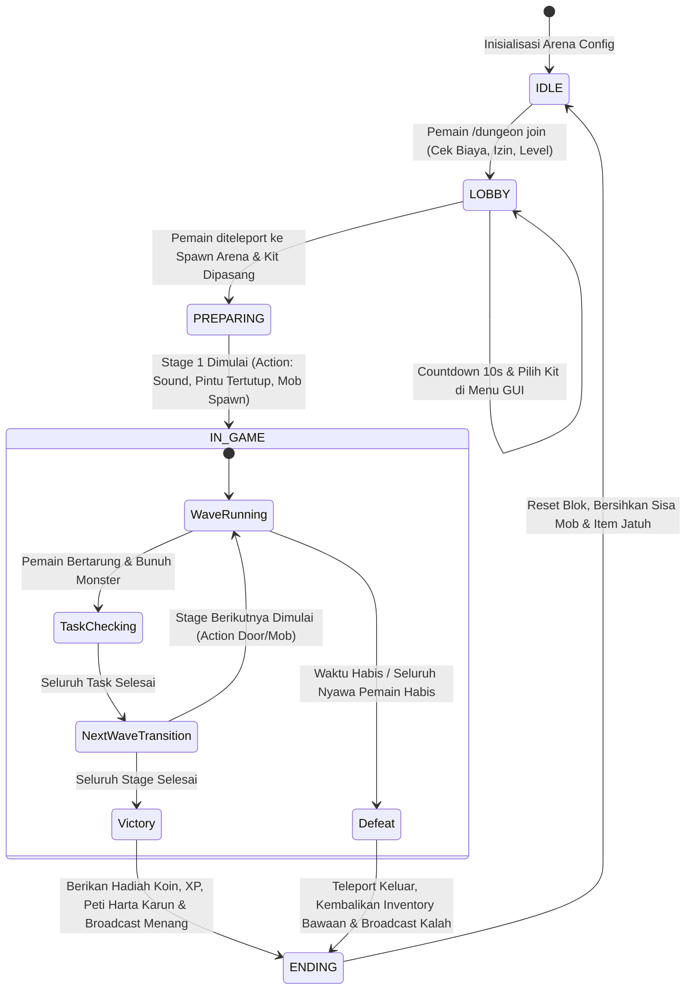

# Rencana Implementasi: Rekonstruksi & Duplikasi Penuh AdvancedDungeonArena-8.6.0 ke Takasha-RPG (Minecraft 26.2 Fabric) Menggunakan Skill REA

> **Target Versi:** `v1.6.0+26.2`  
> **Modul:** `takasha-rpg` (Minecraft 26.2, Fabric 0.161.0, Java 25 LTS)  
> **Mod Sakura-Weapons:** **LOCKED** baku pada `v2.5.0` (Zero-touch, dilarang dimodifikasi)  
> **Referensi Sumber REA:** `referensi-rp\RPG\AdvancedDungeonArena-8.6.0.jar` (Total 317 kelas decompiled bytecode)  
> **Status:** Menunggu Review & Persetujuan Pengguna (Draft Planning Mode)

---

## 1. Goal Description (Deskripsi Tujuan)

Tujuan utama dari proyek ini adalah menduplikasi, merekonstruksi (*reverse engineer*), dan mem-porting seluruh sistem dari plugin Spigot/Paper **`AdvancedDungeonArena-8.6.0`** (oleh NightExpress) menjadi sistem native modular berkinerja tinggi di dalam mod Fabric **`takasha-rpg`** untuk Minecraft 26.2.

Sistem prototype `TakashaArenaManager.java` (yang sebelumnya hanya berupa 5-wave hardcoded zombie arena sederhana) akan digantikan dengan **Takasha Dungeon & Arena Framework** yang lengkap dan data-driven (berbasis JSON/Config):
1. **Multi-Dungeon & Arena Instances**: Mendukung banyak arena dan dungeon sekaligus secara terisolasi.
2. **Cuboid 3D Region & Particle Boundary**: Pemilihan zona dengan wand tool, visualisasi partikel pembatas, dan proteksi anti-griefing/anti-kabur.
3. **Stage & Objective Tasks**: Mendukung variasi objektif multi-tahap (`KillMobs`, `KillBoss`, `ClearLeftovers`, `MoveToArea`, `HoldArea/SurviveTimer`).
4. **Scripting Engine (Actions & Conditions)**: Trigger peristiwa dungeon (pintu terbuka/tertutup otomatis, blok barier berubah, sound VFX, broadcast announcement, spawn mob bergelombang).
5. **Dungeon Mob Engine & Hunting AI**: Mob kustom dengan skala atribut dinamis (HP/Damage naik mengikuti jumlah pemain), perlengkapan kustom, serta AI perburuan (`FollowPlayersGoal`) yang melacak pemain di seluruh penjuru arena tanpa batas jarak pandang vanilla.
6. **Kit Selection System**: Pemilihan perlengkapan kelas (Warrior, Archer, Mage, Tank) sebelum pertandingan dengan GUI menu dan limit per tim.
7. **Loot Chests, Rewards & Live HUD**: Peti harta karun isi ulang berkala, hadiah koin/kristal RPG, dan live scoreboard HUD yang memantau sisa mob, waktu, dan nyawa pemain.

---

## 2. User Review Required (Hal Penting yang Memerlukan Review Pengguna)

> [!IMPORTANT]
> **1. Format Penyimpanan Data Arena & Mob:**  
> Untuk fleksibilitas tanpa perlu recompile mod, seluruh konfigurasi Dungeon, Mob kustom, dan Kit akan disimpan dalam format JSON di direktori server/client `config/takasha_rpg/dungeons/`, `config/takasha_rpg/mobs/`, dan `config/takasha_rpg/kits/`, lengkap dengan contoh default bawaan (*default presets*).
> 
> **2. Skema Perintah Utama:**  
> Perintah kustom akan didaftarkan di bawah namespace `/dungeon` dan `/takasha dungeon` dengan autocompletion lengkap.
> 
> **3. Isolasi Mod Sakura-Weapons:**  
> Mod `sakura-weapons` (`v2.5.0`) tetap berstatus **LOCKED** (zero-touch). Seluruh senjata Sakura akan diakses melalui registry identifier vanilla/Fabric standar (`sakura:katana_*`, dsb.) untuk dimasukkan ke dalam Kit dan Reward.

---

## 3. Hasil Audit REA: Pemetaan Arsitektur 8 Pilar AdvancedDungeonArena

Berdasarkan pembongkaran bytecode 317 kelas `AdvancedDungeonArena-8.6.0.jar`, sistem terbagi ke dalam 8 pilar arsitektur yang akan kita rekonstruksi secara native ke Fabric:

| No | Pilar Arsitektur Asli (NightExpress ADA) | Kelas Sumber REA | Rekonstruksi Native Fabric di `takasha-rpg` | Status Porting |
| :--- | :--- | :--- | :--- | :--- |
| **1** | **Spatial Boundary & Selection** | `SelectionManager`, `CuboidSelection`, `BlockHighlighter` | `DungeonCuboid.java`, `DungeonWandItem.java`, `DungeonRegionRenderer.java` | 100% Native Fabric (Particle Box & Box collision) |
| **2** | **Configuration & Schema** | `DungeonConfig`, `GameSettings`, `Features` | `DungeonConfig.java`, `DungeonGameSettings.java`, `DungeonFeatures.java` | JSON GSON data-driven di `config/takasha_rpg/` |
| **3** | **Instance State Machine** | `DungeonInstance`, `DungeonManager`, `GameState` | `DungeonManager.java`, `DungeonInstance.java`, `DungeonGameState.java` | Server tick loop lifecycle (`LOBBY` -> `PREP` -> `IN_GAME` -> `ENDING`) |
| **4** | **Stage & Task Engine** | `Stage`, `StageTask`, `KillMobsTask`, `MoveToTask` | `DungeonStage.java`, `DungeonTask.java`, `KillMobsTask.java`, `AreaTask.java` | Modular task objective system dengan progress tracking |
| **5** | **Scripting Actions & Conditions** | `Action`, `Condition`, `DoorAction`, `SpawnMobAction` | `DungeonAction.java`, `DungeonCondition.java`, `ActionRegistry.java` | Action dispatcher: Sound, Particle, Door/Block, Message, Command |
| **6** | **Dungeon Mobs & Hunting AI** | `MobTemplate`, `AttributeScale`, `FollowPlayersGoal` | `DungeonMobTemplate.java`, `DungeonMobHunterGoal.java`, `MobScaleEngine.java` | Vanilla Fabric Entity Goal injection (Unlimited Tracking Radius) |
| **7** | **Kit Loadout System** | `KitManager`, `Kit`, `KitSelectMenu` | `DungeonKitManager.java`, `DungeonKit.java`, `DungeonKitMenu.java` | Inventory snapshots, loadout equipping, cooldowns & limits |
| **8** | **HUD Board & Rewards** | `DungeonBoard`, `LootChest`, `Reward`, `DungeonStats` | `DungeonHudManager.java`, `DungeonLootChest.java`, `DungeonReward.java` | Terintegrasi ke `TakashaActionbarHud` & `TakashaRpgManager` |

---

## 4. Alur Kerja Sistem (System Workflow & State Transitions)



---

## 5. Rincian Komponen & Usulan Perubahan File

### Paket Utama: `net.takasha.rpg.dungeon.*`

#### [MODIFY] `TakashaArenaManager.java` -> Dirombak dan didelegasikan ke `DungeonManager.java`
- Mempertahankan backward compatibility untuk pemanggilan command lama, namun seluruh backend digerakkan oleh `DungeonManager`.

#### [NEW] `net/takasha/rpg/dungeon/DungeonManager.java`
- Pengelola global seluruh instance arena dan dungeon di server Fabric.
- Memuat file JSON dari `config/takasha_rpg/dungeons/`.
- Menangani `enterDungeon()`, `leaveDungeon()`, pengecekan proteksi wilayah (`isInDungeon()`), dan event tick server.

#### [NEW] `net/takasha/rpg/dungeon/instance/DungeonInstance.java`
- State machine aktif per arena yang sedang berjalan:
  - Pelacakan countdown lobi, sisa waktu permainan (`timeLeft`), dan stage aktif.
  - Pelacakan pemain (`DungeonGamer`: nyawa, kills, score, kit yang dipilih).
  - Pelacakan mob aktif (`activeMobs`), eliminasi mob mati, dan pembasmian item sampah (`killGroundItems`).
  - Pembersihan blok dan pintu otomatis saat pertandingan usai.

#### [NEW] `net/takasha/rpg/dungeon/stage/DungeonStage.java` & `DungeonTask.java`
- Struktur stage/gelombang:
  - `KillMobsTask`: Menghitung target pembunuhan mob (misal: 15 Zombie, 5 Skeleton).
  - `KillBossTask`: Menargetkan entitas spesifik dengan bossbar kustom.
  - `SurviveTimerTask`: Bertahan hidup selama durasi tertentu.
  - `AreaCheckpointTask`: Pemain harus berkumpul di zona tertentu untuk membuka ruang berikutnya.

#### [NEW] `net/takasha/rpg/dungeon/script/DungeonAction.java` & `DungeonCondition.java`
- Mesin eksekusi skrip dinamis:
  - `SpawnMobAction`: Memunculkan monster di koordinat spot tertentu dengan delay atau efek petir/asap.
  - `DoorAction`: Mengubah blok gerbang (misal: `iron_bars` / `stone_bricks` diubah jadi `air` saat wave selesai, dan kembali ditutup saat wave baru dimulai).
  - `BroadcastAction`: Mengirimkan pesan actionbar, title, subtitle, dan suara atmosferik.
  - `RewardAction`: Memberikan koin Takasha, XP, dan item loot.

#### [NEW] `net/takasha/rpg/dungeon/mob/DungeonMobTemplate.java` & `DungeonMobHunterGoal.java`
- Template mob kustom berbasis JSON:
  - Nama display kustom dengan warna HEX/Formatting.
  - Perlengkapan (armor, senjata dengan custom enchantment Takasha).
  - Atribut berskala (`AttributeScale`): Formula `base + (perPlayer * extraPlayers)`.
- Custom AI Goal:
  - Menginjeksi `DungeonMobHunterGoal` ke `MobEntity` vanilla: mob arena akan terus memburu pemain di dalam arena tanpa batasan jarak `follow_range` biasa.

#### [NEW] `net/takasha/rpg/dungeon/kit/DungeonKitManager.java` & `DungeonKit.java`
- Pengelola kit loadout pemain arena:
  - Kit bawaan: `Swordsman`, `Archer`, `Berserker`, `Paladin/Tank`.
  - GUI pemilihan kit interaktif sebelum timer lobi berakhir.
  - Menyimpan snapshot inventory asli pemain dan mengembalikannya dengan aman saat keluar arena.

#### [NEW] `net/takasha/rpg/dungeon/region/DungeonCuboid.java` & `DungeonWandItem.java`
- Boundary 3D box: `minX, minY, minZ` ke `maxX, maxY, maxZ`.
- Wand admin (`/dungeon wand`): Klik kiri untuk menetapkan Pos1, klik kanan untuk menetapkan Pos2.
- Proteksi blok: Mencegah pemain merusak dinding arena atau menempatkan blok sembarangan jika `adventureMode = true`.

#### [NEW] `net/takasha/rpg/dungeon/hud/DungeonBoardRenderer.java`
- Render status arena ke layar pemain:
  - Terintegrasi dengan Scoreboard sidebar dan Actionbar.
  - Menampilkan: Judul Arena, Gelombang saat ini, Sisa Monster, Nyawa Pemain, dan Sisa Waktu.

#### [NEW] Presets & Default Configs Bawaan (`config/takasha_rpg/`)
- `dungeons/sakura_colosseum.json`: Arena gladiator 5 gelombang dengan boss Sakura Mecha.
- `dungeons/goblin_dungeon.json`: Dungeon 3 ruangan berpintu otomatis.
- `mobs/dungeon_skeleton_sniper.json`, `mobs/dungeon_berserker_zombie.json`, `mobs/dungeon_arena_boss.json`.
- `kits/kit_swordsman.json`, `kits/kit_ranger.json`, `kits/kit_guardian.json`.

---

## 6. Rencana Perintah (Command Structure)

Didaftarkan di bawah `/dungeon` dan `/takasha dungeon`:

```text
/dungeon join <nama_dungeon>            - Masuk ke antrian/lobi dungeon
/dungeon leave                          - Keluar dari dungeon yang sedang berlangsung
/dungeon list                           - Melihat daftar dungeon yang tersedia
/dungeon kit                            - Membuka menu pemilihan kit
/dungeon stats                          - Melihat statistik kemenangan & skor arena pemain

[Admin Commands: Permission Level 2+]
/dungeon wand                           - Mendapatkan tongkat seleksi Pos1 & Pos2
/dungeon create <id> <nama>             - Membuat template dungeon baru
/dungeon setpos1 <id>                   - Menetapkan koordinat Pos1 arena
/dungeon setpos2 <id>                   - Menetapkan koordinat Pos2 arena
/dungeon setlobby <id>                  - Menetapkan titik spawn ruang lobi
/dungeon setspawn <id>                  - Menetapkan titik spawn pemain di arena
/dungeon setexit <id>                   - Menetapkan titik keluar setelah dungeon usai
/dungeon spot add <id> <spot_id>        - Menambahkan titik spawn mob/pintu di posisi berdiri
/dungeon stage add <id> <stage_id>      - Menambahkan tahapan/gelombang baru
/dungeon reload                         - Memuat ulang seluruh konfigurasi JSON dari disk
```

---

## 7. Rencana Verifikasi & Pengujian (Verification Plan)

### A. Pengujian Otomatis (Automated Build & Unit Tests)
1. **Kompilasi Gradle:**
   ```powershell
   ./gradlew :takasha-rpg:build --no-daemon
   ```
   *Kriteria lolos:* Build berhasil tanpa error kompilasi, menghasilkan `Takasha-RPG-1.6.0+26.2.jar`.
2. **JSON Schema Validator:**
   - Script Python otomatis untuk memvalidasi seluruh default JSON configs (dungeon, mob, kit) agar bebas dari syntax error.

### B. Pengujian Manual di Dalam Game (Manual Game Testing)
1. **Seleksi Wilayah & Wand:**
   - Ambil wand `/dungeon wand`, pilih 2 titik arena, pastikan partikel kotak pembatas muncul di batas koordinat.
2. **Setup Dungeon Kustom:**
   - Jalankan `/dungeon create test_arena`, set lobby, set spawn, set spot mob.
3. **Siklus Hidup Permainan (Game Lifecycle):**
   - Jalankan `/dungeon join test_arena`.
   - Pastikan countdown lobi 10 detik berjalan dengan tampilan title/sound.
   - Buka menu pemilihan kit, pilih kit `Swordsman`, pastikan armor dan pedang terpasang.
   - Saat pertandingan dimulai, pastikan Wave 1 spawn mob kustom.
   - Uji AI Mob: Berdiri di kejauhan, pastikan mob tetap mengejar pemain berkat `DungeonMobHunterGoal`.
   - Bunuh seluruh mob Wave 1, pastikan sistem mendeteksi selesai dan beralih ke Wave 2.
   - Selesaikan wave terakhir, pastikan pemain mendapatkan hadiah koin Takasha dan diteleportasi kembali ke titik exit dengan aman.
4. **Proteksi & Isolasi:**
   - Coba hancurkan blok saat di dalam arena (pastikan terblokir jika adventure mode aktif).
   - Pastikan item bawaan pemain sebelum masuk arena kembali utuh 100% setelah keluar.
