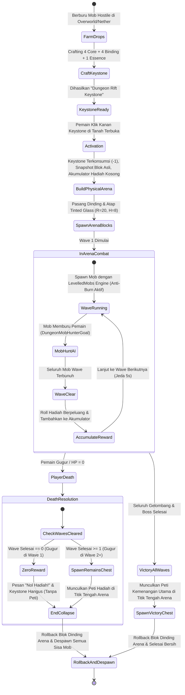

# Rencana Implementasi: Sistem Dungeon Arena Berbasis Blok Fisik, LevelledMobs, Peti Hadiah Per-Wave & Permadeath (Audit Forensik AdvancedDungeonArena)

> **Target Versi Mod:** `takasha-rpg` **`v1.6.0+26.2`** (Minor Feature Release)  
> **Status Dokumen PRD:** Penyelarasan Menuju **`v3.6.0`** (Bab 18: AdvancedDungeonArena Physical Enclosure Engine)  
> **Mod Sakura-Weapons:** **LOCKED** baku pada `v2.5.0` (Zero-touch)  
> **Status:** Menunggu Review & Persetujuan Pengguna (Planning Mode)  

---

## 1. Goal Description (Deskripsi Tujuan)

Mengembangkan sistem **Takasha Dungeon Arena** dinamis yang terinspirasi dari arsitektur Spigot/Paper **`AdvancedDungeonArena-8.6.0`** (oleh NightExpress) dengan adaptasi penuh standar PRD, Semantic Versioning, dan alur gameplay RPG modern:

1. **Pemunculan Peti Hadiah Otomatis di Titik Tengah Arena Saat Dungeon Selesai:**  
   - Ketika dungeon berakhir/selesai, seluruh hadiah akumulasi gelombang yang berhasil diselesaikan diserahkan langsung melalui **Peti Fisik (`Blocks.CHEST`)** di titik aktivasi tengah arena (`centerPos`):
     - **Gugur di Wave 1 (Belum Selesai):** **TIDAK ADA PETI SAMA SEKALI** (0 hadiah, dimensi runtuh seketika, keystone hangus).
     - **Gugur di Wave 2 ke atas (Wave 1+ Sudah Selesai):** Dungeon berakhir, dinding blok di-rollback bersih, dan **Peti Hadiah Sisa Dungeon langsung muncul di titik tengah arena** memuat akumulasi koin fisik `rpg_coin`, `rpg_gold_coin`, `takasha_gem`, scroll, dust, dan drop item RPG berpeluang dari wave-wave yang berhasil diselesaikan.
     - **Selesai Seluruh Gelombang (Victory):** Dinding blok di-rollback bersih, dan **Peti Kemenangan Utama langsung muncul di titik tengah arena** memuat seluruh akumulasi hadiah Wave 1–5 beserta roll drop kelulusan bos.
2. **Batas Fisik Berupa Blok Solid (Physical Block Barrier):**  
   - Dinding silinder dan atap kubah padat (`Blocks.TINTED_GLASS` dan `Blocks.BARRIER`, radius 20 blok, tinggi 8 blok) mengurung arena.
   - Pemain dan monster terkurung rapat di dalam (tidak bisa keluar/kabur).
   - **Rollback 100% (*Zero World Griefing*)**: Seluruh blok asli disimpan dalam snapshot memory (`ArenaBlockSnapshot`) dan dikembalikan utuh ke kondisi semula saat arena selesai atau runtuh, tanpa merusak peti hadiah yang dimunculkan di tengah.
3. **Kekebalan Sinar Matahari Mob Arena (Anti-Daylight Burn):**  
   - Monster undead (Zombie, Skeleton, Phantom, Drowned) dipastikan **TIDAK TERBAKAR** di siang hari melalui atap tinted glass, efek permanen `FIRE_RESISTANCE`, dan pembersihan `remainingFireTicks` otomatis.
4. **Integrasi Mesin LevelledMobs (Lvl 1 - 1000):**  
   - Penskalaan atribut non-linear dari `TakashaMobLevelManager`: Max HP bertingkat, Attack Damage, True Damage (Lvl 600+), dan **Anti-Melt Damage Cap (15% Max HP/hit)** untuk Boss Lvl 750-1000.
   - Indikator nametag LevelledMobs: `§8[§cLvl %lvl%§8] §f%name% §8[§a%health_bar%§8] §e%hp%/%maxhp%`.
5. **Aktivasi Sekali Pakai dari Drop Mob Khusus (Consumable Rift Keystone) & Tekstur Asli dari Referensi:**  
   - Pemain mengumpulkan 3 bahan drop langka: `Dungeon Core Fragment`, `Runic Essence`, dan `Abyssal Binding Thread`.
   - Dibuat menjadi item sekali pakai: `Dungeon Rift Keystone` (Tersedia Tier *Common*, *Nightmare*, dan *Sakura Boss*).
   - **Semua tekstur diambil 100% langsung dari referensi resmi (`referensi-rp\RPG\Item-custom\Fuben` & `RPGBundle`)**, identik dengan metode penyusunan zirah dan relik Takasha RPG sebelumnya tanpa aset tiruan/placeholder:
     - `Dungeon Core Fragment`: `referensi-rp\RPG\Item-custom\Fuben\contents\fuben\resourcepack\fuben\textures\item\gem\fb_gem_10.png`
     - `Runic Essence`: `referensi-rp\RPG\Item-custom\Fuben\contents\fuben\resourcepack\fuben\textures\item\gem\fb_gem_104.png`
     - `Abyssal Binding Thread`: `referensi-rp\RPG\Item-custom\Fuben\contents\fuben\resourcepack\fuben\textures\item\fb_item\fb_60.png`
     - `Dungeon Rift Keystone (Common)`: `referensi-rp\RPG\Item-custom\Fuben\contents\fuben\resourcepack\fuben\textures\item\gem\fb_gem_1.png`
     - `Dungeon Rift Keystone (Nightmare)`: `referensi-rp\RPG\Item-custom\Fuben\contents\fuben\resourcepack\fuben\textures\item\gem\fb_gem_110.png`
     - `Dungeon Rift Keystone (Sakura Boss)`: `referensi-rp\RPG\Item-custom\Fuben\contents\fuben\resourcepack\fuben\textures\item\gem\fb_gem_125.png`
   - Klik kanan di area terbuka untuk mengonsumsi 1 item dan memunculkan struktur arena seketika.

---

## 2. Kebijakan Semantic Versioning (SemVer) & Penyelarasan PRD

Berdasarkan pedoman PRD (*Product Requirements Document*) Bab 1 & Bab 17:
- **`takasha-rpg`**: Ditingkatkan dari `v1.5.0` ke **`v1.6.0`** (`v1.6.0+26.2`).  
  *Justifikasi SemVer:* Penambahan fitur fungsionalitas besar baru (sistem AdvancedDungeonArena, blok fisik arena, integrasi LevelledMobs, drop shards, consumable keystone, dan reward chest) yang sepenuhnya *backward-compatible*.
- **`sakura-weapons`**: Tetap terkunci baku pada **`v2.5.0`** (**LOCKED**, zero-touch).
- **`PRD.md`**: Ditingkatkan dari `v3.5.0` ke **`v3.6.0`** dengan penambahan *Bab 18: AdvancedDungeonArena Physical Enclosure Engine*.

---

## 3. User Review Required (Hal Penting yang Memerlukan Review Pengguna)

> [!IMPORTANT]
> **1. Integrasi Mata Uang `rpg_coin` & `rpg_gold_coin` dengan EconomyShopGUI:**  
> - **Status:** **SUDAH TERINTEGRASI 100% SECARA NATIVELY!**
> - Item fisik `rpg_coin` ($1) dan `rpg_gold_coin` ($100) menggunakan class `TakashaCurrencyItem`.
> - **Mekanisme:** Pemain memegang koin lalu **Klik Kanan** (atau **Shift + Klik Kanan** untuk seluruh stack). Koin akan langsung disetor ke saldo dompet virtual pemain (`TakashaRpgData.addBalance()`).
> - **Item Apa Saja yang Dapat Dibeli dengan Koin Ini di `/shop`?**  
>   Saldo dompet tersebut dapat dibelanjakan di **17 Kategori Pasar Lengkap EconomyShopGUI**:
>   1. **Buku Enchantment Tingkat Tinggi (`Enchanting.yml`):** Sharpness V ($972.41), Protection IV, Mending, Silk Touch ($200), Density V ($3.889,62), Breach IV ($1.852,20), Unbreaking III, dsb.
>   2. **Bijih Logam & Mineral Langka (`Ores.yml`):** Ancient Debris ($529), Diamond ($52.50), Emerald ($39.38), Gold Ingot ($8.27), Netherite, dsb.
>   3. **Mob Spawners (`Spawners.yml`):** Blaze Spawner ($125.000), Breeze Spawner ($100.000), Allay ($225.000), Iron Golem Spawner, Skeleton/Zombie Spawner.
>   4. **Spawn Eggs Seluruh Mob (`SpawnEggs.yml`):** Berbagai telur pemanggil mob vanilla untuk keperluan peternakan & farm otomatis.
>   5. **Peralatan, Zirah & Senjata Langka (`Z_EverythingElse.yml`):** Full Armor Netherite, Diamond Tools, Bows, Elytra, Tridents, Maces.
>   6. **Bahan Jatuhan Mob & Bos (`Mobs.yml`):** Nether Star, Wither Skeleton Skull, Shulker Shell, Blaze Rod, Ghast Tear, Phantom Membrane, Totem of Undying.
>   7. **Makanan & Potion Legendaris (`Food.yml`, `Potions.yml`):** Enchanted Golden Apple (Notch Apple - $5.000), Golden Apple ($275.10), Potion Kekuatan, Regenerasi, dsb.
>   8. **Toko Diskon Berotasi (`RotatingShop.yml`):** Penawaran diskon khusus harian/per-jam yang selalu berganti.
>   9. **Bahan Konstruksi & Redstone:** Berbagai blok bangunan, repeater, komparator, piston, hopper, dan workstation.
>
> **2. Pemunculan Peti di Titik Tengah Saat Dungeon Selesai:**  
> - Ketika dungeon selesai (baik menang penuh maupun gugur setelah menyelesaikan minimal 1 wave), peti hadiah `Blocks.CHEST` langsung ditempatkan di titik tengah arena (`centerPos`).
> - Pemain tinggal membuka peti tersebut di lokasi arena untuk mengambil hadiahnya.
> - Jika gugur di Wave 1 sebelum gelombang selesai: Arena lenyap total dan **tidak ada peti yang muncul** (0 hadiah).
>
> **3. Tabel Akumulasi Hadiah Per-Wave di Dalam Peti (Setiap Item RPG Memiliki Peluang / Chance Eksplisit):**  
>
> | Wave | Tingkat LevelledMobs | Hadiah Tetap (Mata Uang & Utilitas Dust/Scroll) | Hadiah Peluang Item RPG Takasha & Set Kit AE (Dengan Probabilitas Eksplisit) |
> | :---: | :---: | :--- | :--- |
> | **Wave 1** | Lvl 30 – 50 (Common) | • 50 RPG Coins ($50)<br>• 2 Magic Dust | • **Peluang 40%**: 1x `Mystery Book (Simple)`<br>• **Peluang 15%**: Relik Dasar (*Astrolabe Navigator* `/getpos` atau *Tear of the Frostborn* `/ext`) |
> | **Wave 2** | Lvl 60 – 90 (Common) | • 120 RPG Coins ($120)<br>• 4 Magic Dust<br>• 1 Mystery Dust | • **Peluang 45%**: 1x `Mystery Book (Unique)`<br>• **Peluang 30%**: 1x Stat Tracker Acak (*Kills / Mobs / Blocks*)<br>• **Peluang 20%**: Jimat Pemulih (*Dreamcatcher Charm* `/rest`) |
> | **Wave 3** | Lvl 100 – 150 (Uncommon) | • 250 RPG Coins ($250)<br>• 1 RPG Gold Coin ($100) | • **Peluang 40%**: 1x `Mystery Book (Elite)`<br>• **Peluang 25%**: 1x `Mystery Book (Ultimate)`<br>• **Peluang 35%**: 1–2 Item Acak Utilitas AE *(Slot Increaser 1 / Secret Dust / Randomization Scroll)*<br>• **Peluang 20%**: Kitab Portabel Kuno (*Tome of Workbench* `/workbench`, *Scroll of Ascension* `/top`, atau *Wanderer Compass* `/tpr`) |
> | **Wave 4** | Lvl 180 – 220 (Uncommon) | • 500 RPG Coins ($500)<br>• 2 RPG Gold Coins ($200)<br>• 1 White Scroll | • **Peluang 45%**: **1x ANCIENT KEYSTONE (+1 Slot Max Home, batas maksimal 10)**<br>• **Peluang 30%**: 1x `Mystery Book (Legendary)`<br>• **Peluang 15%**: 1x `Mystery Book (Fabled)`<br>• **Peluang 35%**: 1–2 Item Acak Set Kit AE *(Pilihan acak: Helmet, Chestplate, Leggings, atau Boots dari Phantom/Ranger)*<br>• **Peluang 20%**: Kitab Tempa Kuno (*Tome of Anvil* `/anvil`, *Tome of Smithing* `/smithingtable`, atau *Tome of Grindstone* `/grindstone`) |
> | **Wave 5 (Boss)** | Lvl 300 (Elite Boss) | • 1.000 RPG Coins ($1.000)<br>• 5 RPG Gold Coins ($500)<br>• 3 Takasha Gems<br>• 1 Holy Scroll | **PETI KEMENANGAN UTAMA (VICTORY CHEST):**<br>• **Peluang 75%**: **1x ANCIENT KEYSTONE (+1 Slot Max Home, hingga batas 10)**<br>• **Peluang 50%**: 1x `Mystery Book (Heroic)`<br>• **Peluang 25%**: 1x `Mystery Book (Soul)`<br>• **Peluang 10%**: 1x `Mystery Book (Mastery)`<br>• **Peluang 45%**: 1–2 Item Acak Set Kit AE Tingkat Tinggi *(Set Kit Mythic/Legendary: Koth, Supreme, Yeti, Dimensional Traveller, Yijki)*<br>• **Peluang 25%**: Senjata Kosmik AE Acak *(Phantom Scythe, Koth Sword/Axe, Dimensional Sword, Supreme Weapon)*<br>• **Peluang 25%**: Relik Sakral Eksekutif Acak (*Palu Tempa Master `/repair`, Palu Suci Dewata `/repair all`, Sigil Vitalitas `/heal`, Sigil Kemakmuran `/feed`, atau Peti Ender Kuno `/enderchest`*)<br>• **Peluang 35%**: 1x Soul Gem atau Weapon/Armor Enchantment Orb |
>
> *(Matriks Peluang Tier Tinggi: Untuk Keystone Tier **Nightmare** dan **Sakura Boss**, peluang Ancient Keystone meningkat menjadi 85% dan 95%, Mystery Book Soul menjadi 50% dan 75%, Mystery Book Mastery menjadi 25% dan 45%, serta peluang Senjata Kosmik meningkat menjadi 50% dan 75%).*
>
> **4. Daftar Lengkap Perintah (Commands) Khusus & Murni Dungeon Arena (AdvancedDungeonArena):**  
> *(Hanya perintah yang terikat langsung pada sistem arena, dengan alias resmi `/dungeon`, `/arena`, `/dungeons`, `/ada` tanpa mencampur perintah fitur RPG lainnya)*:
>
> **A. Perintah Dungeon Mode Survival (Akses Seluruh Pemain Tanpa OP):**
> - `/dungeon leave` (alias `/arena leave` / `/dungeon forfeit`) — Menyerah dan keluar dari arena aktif (dihitung gugur pada gelombang tersebut; kubah blok di-rollback bersih, dan peti hadiah sisa wave sebelumnya dimunculkan jika wave $\ge$ 1 telah diselesaikan).
> - `/dungeon info` (alias `/arena info`) — Melihat status dungeon arena yang sedang aktif (gelombang berjalan, sisa monster hidup, jumlah wave selesai, dan durasi).
>
> **B. Perintah Dungeon Mode Creative / Operator / Admin (Permission Level 2):**
> - `/dungeon start [common|nightmare|sakura_boss] [pemain]` (alias `/arena start ...`) — Memulai dungeon arena secara instan di lokasi pemain tanpa memerlukan item keystone (untuk pengujian instan).
> - `/dungeon stop [pemain]` (alias `/arena stop`) — Menghentikan dungeon aktif seketika, mendespawn seluruh mob dungeon, dan me-rollback blok arena ke kondisi semula.
> - `/dungeon setstage <nomor_stage>` (alias `/dungeon wave set`) — Melompat langsung ke gelombang/stage tertentu untuk menguji mob atau boss spesifik.
> - `/dungeon setlevel <common|nightmare|sakura_boss>` — Mengatur tingkat kesulitan/tier arena.
> - `/dungeon givekeystone <pemain> <common|nightmare|sakura_boss> [jumlah]` — Memberikan item konsumsi keystone langsung ke inventaris pemain.
> - `/dungeon reload` — Memuat ulang konfigurasi dan loot table dungeon arena.
> - `/dungeon rollback` — Memaksa pembersihan & pemulihan darurat snapshot blok arena jika terjadi interupsi.

---

## 4. Alur Kerja Sistem (System Workflow & State Machine)



---

## 5. Rincian Komponen & Usulan Perubahan File

### Komponen 1: Manajemen Peti Hadiah di Titik Tengah (`net.takasha.rpg.dungeon.reward.*`)

#### [NEW] `net/takasha/rpg/dungeon/reward/DungeonRewardChestManager.java`
- Menempatkan peti fisik di titik tengah arena (`centerPos`) dan mengisinya dengan seluruh item hadiah akumulasi saat dungeon selesai:
  ```java
  public class DungeonRewardChestManager {
      public static BlockPos spawnChestWithLoot(ServerLevel level, BlockPos centerPos, List<ItemStack> lootItems, String chestCustomName) {
          BlockPos safePos = findSafeGround(level, centerPos);
          level.setBlockAndUpdate(safePos, Blocks.CHEST.defaultBlockState());
          
          if (level.getBlockEntity(safePos) instanceof ChestBlockEntity chest) {
              if (chestCustomName != null) {
                  chest.setCustomName(Component.literal(chestCustomName));
              }
              for (int i = 0; i < lootItems.size() && i < chest.getContainerSize(); i++) {
                  chest.setItem(i, lootItems.get(i).copy());
              }
              chest.setChanged();
          }
          return safePos;
      }
      
      private static BlockPos findSafeGround(ServerLevel level, BlockPos pos) {
          BlockPos.MutableBlockPos m = pos.mutable();
          while (m.getY() > level.getMinY() && (level.getBlockState(m).isAir() || level.getBlockState(m).canBeReplaced())) {
              m.move(Direction.DOWN);
          }
          return m.above().immutable();
      }
  }
  ```

#### [NEW] `net/takasha/rpg/dungeon/reward/DungeonRewardAccumulator.java`
- Mengakumulasi item mata uang fisik (`rpg_coin`, `rpg_gold_coin`, `takasha_gem`), scroll, dust, serta item RPG Takasha dan AdvancedEnchantments yang diundi dengan probabilitas persentase (`random.nextFloat() < chance`):
  - *Wave 1:* 50 RPG Coins, 2 Magic Dust + Peluang 40% `Mystery Book (Simple)` + Peluang 15% Relik Dasar (*Astrolabe Navigator* `/getpos` / *Tear of the Frostborn* `/ext`).
  - *Wave 2:* 120 RPG Coins, 4 Magic Dust, 1 Mystery Dust + Peluang 45% `Mystery Book (Unique)` + Peluang 30% Stat Tracker Acak + Peluang 20% Jimat Pemulih (*Dreamcatcher Charm* `/rest`).
  - *Wave 3:* 250 RPG Coins, 1 RPG Gold Coin + Peluang 40% `Mystery Book (Elite)` + Peluang 25% `Mystery Book (Ultimate)` + Peluang 35% 1–2 Item Acak Utilitas AE (*Slot Increaser 1*, *Secret Dust*, *Randomization Scroll*) + Peluang 20% Kitab Portabel (*Tome of Workbench* `/workbench`, *Scroll of Ascension* `/top`, *Wanderer Compass* `/tpr`).
  - *Wave 4:* 500 RPG Coins, 2 RPG Gold Coins, 1 White Scroll + **Peluang 45% 1x `Ancient Keystone` (+1 Slot Max Home)** + Peluang 30% `Mystery Book (Legendary)` + Peluang 15% `Mystery Book (Fabled)` + Peluang 35% 1–2 Item Acak Set Kit AE (Helm, Chestplate, Leggings, atau Boots dari Phantom/Ranger) + Peluang 20% Kitab Tempa Langka (*Tome of Anvil* `/anvil`, *Tome of Smithing* `/smithingtable`).
  - *Wave 5 (Boss):* 1.000 RPG Coins, 5 RPG Gold Coins, 3 Takasha Gems, 1 Holy Scroll + **Peluang 75% 1x `Ancient Keystone` (+1 Slot Max Home)** + Peluang 50% `Mystery Book (Heroic)` + Peluang 25% `Mystery Book (Soul)` + Peluang 10% `Mystery Book (Mastery)` + Peluang 45% 1–2 Item Acak Set Kit AE Legendaris/Mythic (Koth, Supreme, Yeti, dsb) + Peluang 25% Senjata Kosmik (`Phantom Scythe`, `Koth Sword/Axe`, `Dimensional Sword`, `Supreme Weapon`) + Peluang 25% Relik Sakral Eksekutif Acak (*Palu Tempa Master* `/repair`, *Palu Suci* `/repair all`, *Sigil Vitalitas* `/heal`, *Sigil Kemakmuran* `/feed`, atau *Peti Ender Kuno* `/enderchest`) + Peluang 35% Soul Gem atau Weapon/Armor Orb.
- Mengonversi seluruh hadiah menjadi `List<ItemStack>` untuk dimasukkan ke dalam peti hadiah di titik tengah saat dungeon selesai.

---

### Komponen 2: Blok Fisik Arena & Rollback Terproteksi (`net.takasha.rpg.dungeon.arena.*`)

#### [NEW] `net/takasha/rpg/dungeon/arena/ArenaBlockSnapshot.java`
- Mencatat seluruh blok yang diubah menjadi dinding atau atap `Blocks.TINTED_GLASS` dan `Blocks.BARRIER`.
- Fitur `restoreAllExcept(ServerLevel level, BlockPos preservedChestPos)`:
  - Mengembalikan seluruh blok semula, **tanpa menimpa blok peti hadiah yang berada di titik tengah**.

#### [MODIFY] `net/takasha/rpg/dungeon/TakashaArenaManager.java` -> Dirombak Menjadi `DungeonArenaEngine.java`
- Membangun silinder kubah blok fisik:
  - Radius: 20 blok, Tinggi: 8 blok.
  - Penanganan ketika dungeon selesai:
    - Jika `completedWaves == 0` (Gugur di Wave 1): Rollback seluruh blok arena, despawn mob, kirim pesan merah (*Nol hadiah, tanpa peti*).
    - Jika `completedWaves >= 1` (Gugur di Wave 2+): Rollback blok arena di sekitarnya, despawn mob, dan langsung munculkan peti hadiah di titik tengah arena.
    - Jika menang penuh: Rollback blok arena di sekitarnya, munculkan Peti Kemenangan Utama di titik tengah dengan bonus bos.

---

### Komponen 3: Integrasi LevelledMobs & Anti-Daylight Burn (`net.takasha.rpg.world.*`)

#### [MODIFY] `net/takasha/rpg/world/TakashaMobLevelManager.java`
- Method pembantu: `applyExplicitLevel(LivingEntity entity, int targetLevel, boolean isBoss)`.
- Mengatur atribut Max HP, Damage, True Damage (Lvl 600+), dan Anti-Melt Cap (15% Max HP/hit) untuk Boss Lvl 750+.
- Mencegah mob undead terbakar sinar matahari:
  - Atap Tinted Glass memblokir skylight.
  - Efek permanen `FIRE_RESISTANCE`.
  - Penutup kepala anti-sunburn dan pembersihan `fireTicks = 0`.

---

### Komponen 4: Drop Engine, Keystone Item & Aset Tekstur Referensi (`net.takasha.rpg.item.*`)

#### [ASET RESMI] Integrasi Tekstur Langsung dari Folder Referensi (`referensi-rp\RPG\Item-custom\Fuben`):
| Item Takasha RPG | Sumber Tekstur Asli di Referensi | Tujuan di `takasha-rpg` |
| :--- | :--- | :--- |
| `dungeon_core_fragment` | `referensi-rp\RPG\Item-custom\Fuben\contents\fuben\resourcepack\fuben\textures\item\gem\fb_gem_10.png` | `takasha-rpg\src\main\resources\assets\takasha_rpg\textures\item\dungeon\dungeon_core_fragment.png` |
| `runic_essence` | `referensi-rp\RPG\Item-custom\Fuben\contents\fuben\resourcepack\fuben\textures\item\gem\fb_gem_104.png` | `takasha-rpg\src\main\resources\assets\takasha_rpg\textures\item\dungeon\runic_essence.png` |
| `abyssal_binding_thread` | `referensi-rp\RPG\Item-custom\Fuben\contents\fuben\resourcepack\fuben\textures\item\fb_item\fb_60.png` | `takasha-rpg\src\main\resources\assets\takasha_rpg\textures\item\dungeon\abyssal_binding_thread.png` |
| `keystone_common` | `referensi-rp\RPG\Item-custom\Fuben\contents\fuben\resourcepack\fuben\textures\item\gem\fb_gem_1.png` | `takasha-rpg\src\main\resources\assets\takasha_rpg\textures\item\dungeon\keystone_common.png` |
| `keystone_nightmare` | `referensi-rp\RPG\Item-custom\Fuben\contents\fuben\resourcepack\fuben\textures\item\gem\fb_gem_110.png` | `takasha-rpg\src\main\resources\assets\takasha_rpg\textures\item\dungeon\keystone_nightmare.png` |
| `keystone_sakura` | `referensi-rp\RPG\Item-custom\Fuben\contents\fuben\resourcepack\fuben\textures\item\gem\fb_gem_125.png` | `takasha-rpg\src\main\resources\assets\takasha_rpg\textures\item\dungeon\keystone_sakura.png` |

#### [NEW] `net/takasha/rpg/item/DungeonRiftKeystoneItem.java`
- Consumable item sekali pakai (Tiers: *Common*, *Nightmare*, *Sakura Boss*).
- Mengurangi stack 1 saat dipakai (`itemStack.shrink(1)`).

#### [MODIFY] `net/takasha/rpg/registry/ModRpgItems.java`
- Registrasi item bahan drop: `DUNGEON_CORE_FRAGMENT`, `RUNIC_ESSENCE`, `ABYSSAL_BINDING`.
- Registrasi item keystone: `DUNGEON_KEYSTONE_COMMON`, `DUNGEON_KEYSTONE_NIGHTMARE`, `DUNGEON_KEYSTONE_SAKURA`.

#### [NEW] `net/takasha/rpg/dungeon/drop/DungeonDropEngine.java`
- Menangani drop persentase dari mob hostile vanilla dengan scaling enchant `Looting`.

#### [NEW] `net/takasha/rpg/dungeon/ai/DungeonMobHunterGoal.java`
- AI Goal berburu pemain agresif tanpa batas jarak vanilla (*infinite tracking* di dalam arena).

---

### Komponen 5: Registrasi Perintah Khusus & Murni Dungeon Arena (`net.takasha.rpg.command.*`)

#### [MODIFY] `net/takasha/rpg/command/TakashaRpgCommands.java`
- Memperluas `registerArenaCommands(dispatcher)` dengan alias resmi AdvancedDungeonArena (`/dungeon`, `/arena`, `/dungeons`, `/ada`):
  - **Akses Mode Survival (Seluruh Pemain Tanpa OP):**
    - `leave` (alias `forfeit`): Menyerah dan keluar dari arena (dihitung gugur pada gelombang tersebut, kubah blok di-rollback bersih, memunculkan peti akumulasi jika wave >= 1 selesai).
    - `info`: Menampilkan status aktif arena (gelombang berjalan, sisa mob hidup, waktu).
  - **Akses Mode Creative / Admin / OP (Permission Level 2):**
    - `start [tier] [player]`: Menjalankan dungeon arena instan di lokasi pemain tanpa keystone.
    - `stop [player]`: Menghentikan dungeon aktif seketika, despawn mob, dan rollback bersih.
    - `setstage <nomor_stage>` (alias `wave set`): Melompat langsung ke gelombang tertentu untuk pengujian.
    - `setlevel <tier>`: Mengatur tingkat kesulitan/tier arena (common, nightmare, sakura_boss).
    - `givekeystone <player> <tier> [amount]`: Memberikan item keystone pemanggil arena ke pemain.
    - `reload`: Memuat ulang konfigurasi dan loot table dungeon arena.
    - `rollback`: Memaksa rollback darurat struktur blok arena jika terjadi interupsi.
  *(Perintah utilitas RPG lainnya seperti `/home`, `/shop`, `/sellgui` tidak diikutsertakan di command tree ini agar murni terdedikasi untuk sistem dungeon arena).*

---

### Komponen 6: Penyelarasan Versi & PRD Dokumen

#### [MODIFY] `takasha-rpg/build.gradle`
- Memperbarui versi: `def globalModVersion = '1.6.0'`.

#### [MODIFY] `PRD.md`
- Meningkatkan versi ke `v3.6.0`.
- Menambahkan dokumentasi *Bab 18: AdvancedDungeonArena Physical Enclosure Engine*.

---

## 6. Rencana Pengujian & Verifikasi (Verification Plan)

### A. Pengujian Otomatis (Compilation)
```powershell
./gradlew :takasha-rpg:build --no-daemon
```
*Ekspektasi:* Kompilasi sukses tanpa error, menghasilkan artefak `Takasha-RPG-1.6.0+26.2.jar`.

### B. Pengujian Manual di Dalam Game (Manual Testing)
1. **Uji Kasus 1: Gugur di Wave 1 (Nol Peti & Nol Hadiah)**
   - Aktifkan `Dungeon Rift Keystone`.
   - Kubah blok terbentuk, Wave 1 spawn.
   - Biarkan diri gugur di Wave 1.
   - **Verifikasi:**
     - Muncul pesan merah: *"Kamu gugur sebelum menyelesaikan Wave 1! Tidak ada hadiah yang berhasil diselamatkan."*
     - **TIDAK ADA PETI SAMA SEKALI**.
     - Blok dinding arena langsung kembali bersih semula.
     - Seluruh monster Wave 1 langsung despawn.
2. **Uji Kasus 2: Gugur di Wave 3 (Peti Hadiah Muncul di Titik Tengah)**
   - Aktifkan Keystone baru di suatu lokasi.
   - Kalahkan Wave 1 & Wave 2.
   - Di Wave 3, biarkan diri gugur.
   - **Verifikasi:**
     - Muncul pesan kuning: *"Dungeon selesai! Peti Hadiah berisi hadiah Wave 1 & 2 telah muncul di lokasi arena!"*
     - Datangi kembali koordinat arena.
     - **Peti Hadiah Fisik Muncul di Titik Tengah**: Buka peti, pastikan terdapat koin RPG fisik, Magic Dust, Mystery Dust, dan koin emas dari Wave 1 & 2 serta item RPG berpeluang yang berhasil didapatkan.
     - Blok kubah dinding arena sudah bersih kembali seperti semula tanpa merusak peti di tengah.
3. **Uji Kasus 3: Kemenangan Penuh (Peti Kemenangan Utama di Titik Tengah)**
   - Selesaikan Wave 1 sampai Wave 5 (Boss).
   - **Verifikasi:**
     - Peti Kemenangan Utama langsung muncul di titik tengah arena.
     - Buka peti, pastikan seluruh hadiah Wave 1–5 lengkap beserta roll drop kelulusan bos.
4. **Uji Anti-Daylight Burn & Batas Blok:**
   - Aktifkan di siang hari terik, pastikan monster undead tidak terbakar.
   - Coba lari keluar dinding tinted glass, pastikan terhalang secara fisik.
5. **Uji Konsistensi Tekstur:**
   - Pastikan item `dungeon_core_fragment`, `runic_essence`, `abyssal_binding_thread`, dan 3 tier keystone menampilkan tekstur pixel art otentik dari referensi `Fuben`.
