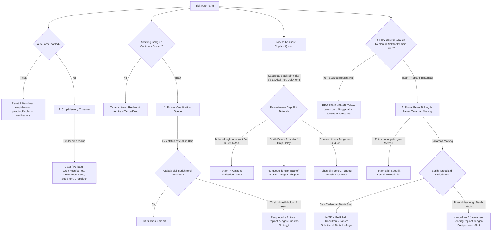

# [PLAN] Takasha Auto-Farm Crop Plot Memory & Resilient Replant Engine

> **Target Rilis SemVer:** Takasha Core Weapons **v2.8.0+26.2** & **v2.6.0+1.21.11** | Root VERSION **2.8.0** | PRD **v4.4.0**  
> **Status:** Siap Eksekusi (Diselaraskan dengan PRD.md & arahan: Replant Mengimbangi Kecepatan Panen)

---

## 1. Masalah & Analisis Akar Masalah (Root Causes)

Pengguna menyampaikan kebutuhan:
> *"saya mengalami masalah pada mod takasha bagian autofarm dimana tidak dapat menanam kembali secara optimal, masih ada tempat yang bolong, seperti memory nya hilang."*  
> *Catatan 1:* **"seperti dlu yang disimpan pada sesi autofarm aktif"**  
> *Catatan 2:* **"pada replant, pastikan mengimbangi dengan kecepatan panen. perbaiki planning"**

Berdasarkan audit teknis mendalam terhadap kode [TakashaFarmHandler.java](file:///d:/Mod%20Minecraft/weapon%20set/sakura/sakura-weapons/versions/1.21.11/src/main/java/net/sakura/weapons/client/farming/TakashaFarmHandler.java) pada subproject `versions/1.21.11` dan `versions/26.2`, ditemukan 8 akar masalah krusial:

1. **Ketimpangan Kecepatan Panen vs Replant (*Harvest-Replant Speed Asymmetry & Race Condition*)**:
   - Pemanenan (*harvesting*) berjalan sangat cepat (`farmActionsPerTick = 12`, `farmActionDelayMs = 0ms`). Dalam 5 tick saja, sistem dapat menghancurkan 60 tanaman sekaligus.
   - Namun, proses replanting lama **dipisahkan secara tick** (panen di tick $N$, replant dijadwalkan ke tick $N+1$ atau ditunda oleh `farmReplantDelayMs`).
   - Ketika pemain berlari cepat (*sprint*) melintasi kebun sambil memanen, pemanenan "lari meninggalkan" penanaman. Pada saat giliran antrean replant tiba di tick berikutnya, pemain sudah melangkah menjauh ($>4.5$ blok) dari petak yang baru dipanen. Paket tanam ditolak server, meninggalkan jalur tanah bolong yang panjang di belakang pemain.

2. **Kehilangan Memori Replant Seketika (*Instant Memory Drop*)**:
   - Di `processPendingReplants()`, seluruh antrean `pendingReplants` langsung di-`clear()`.
   - Jika saat giliran tanaman diperiksa, benih belum ada di tas pemain (karena baru saja dipanen dan *item drops* memiliki delay magnet/pickup vanilla 10 tick atau ~500ms), pemanggilan `ensureOffhandHasSeed(...)` menghasilkan `false`.
   - Kode lama langsung mengeksekusi `continue;` **tanpa menyimpan kembali** entri tersebut ke antrean replant! Tugas replant terhapus permanen dari memori. Saat benih akhirnya tersedot ke tas pemain 0.5 detik kemudian, sistem sudah lupa bahwa petak tersebut harus ditanam kembali ("seperti memory nya hilang").

3. **Batas Retry yang Terlalu Singkat (Hanya 300ms) & Hanya untuk Blok Non-Air**:
   - Retry lama hanya ada pada kondisi `!currentState.isAir() && !currentState.canBeReplaced()`, dibatasi hanya 3 kali dengan jeda 100ms.
   - Jika server mengalami ping > 150ms atau server tick drop, blok belum hancur di sisi server saat 300ms habis, dan replant dibatalkan permanen.

4. **Ketiadaan *Crop Plot Memory Map* (Peta Memori Lahan)**:
   - Mod tidak memiliki catatan jangka panjang tentang jenis tanaman apa yang seharusnya ada di koordinat tertentu `(x, y, z)`.
   - Fitur `autoPlantEmptyFarmland` hanya mengecek `Blocks.FARMLAND` dengan urutan prioritas kaku (*Wheat* -> *Carrot* -> *Potato* -> *Beetroot*). Jika kebun wortel memiliki lahan bolong dan pemain memegang 1 biji gandum, sistem menanam gandum di kebun wortel!
   - Nether wart di `Blocks.SOUL_SAND` dan Cocoa di `Blocks.JUNGLE_LOG` sama sekali tidak didukung oleh `autoPlantEmptyFarmland`.

5. **Ketiadaan Pengecekan Jangkauan Interaksi (*Reach Distance Check*)**:
   - Konfigurasi `farmRadiusH` dapat mencapai 6 blok, sedangkan jarak interaksi vanilla pemain survival menanam blok adalah maksimal 4.5 blok.
   - Ketika paket penanaman dikirim ke koordinat berjarak > 4.5 blok, server menolak penanaman secara diam-diam (*silent rejection*). Klien menganggap tanaman sudah tertanam dan menghapusnya dari antrean.

6. **Spam & Desync Swap Offhand**:
   - Saat banyak tanaman dipanen sekaligus (`farmActionsPerTick = 12`), `ensureOffhandHasSeed` mengirim paket `ClickType.SWAP` / `ContainerInput.SWAP` berkali-kali dalam 1 tick yang sama.
   - Paket `useItemOn` dikirim sebelum server menyelesaikan pertukaran slot inventaris, sehingga server menolak penanaman.

7. **Benturan dengan Auto /sellgui**:
   - Ketika inventaris penuh dan `/sellgui` dijalankan, pemain tidak dapat mengambil benih yang berjatuhan. Pada saat yang sama, `processPendingReplants` memeriksa tas, melihat tidak ada benih, lalu menghapus semua antrean penanaman.

8. **Ketiadaan Verifikasi Pasca-Tanam (*Planting Verification Loop*)**:
   - Setelah `client.gameMode.useItemOn(...)`, tidak ada pengecekan ulang apakah blok tersebut benar-benar berhasil menjadi tanaman di tick berikutnya.

---

## 2. Keputusan Desain & Arahan Terkonfirmasi (Confirmed Decisions)

> [!IMPORTANT]
> **1. Penyimpanan Memori Lahan (*Session-Bound Crop Plot Memory*) — DISETUJUI**:
> - Memori plot lahan disimpan secara **in-memory selama sesi autofarm aktif** (`config.autoFarmEnabled == true`).
> - Memori mencatat koordinat dan jenis tanaman secara pasif saat pemain beraktivitas di kebun.
> - Saat Auto-Farm dimatikan (`autoFarmEnabled = false`), seluruh memori plot dan antrean dibersihkan bersih (*zero residual memory leak*).

> [!IMPORTANT]
> **2. Sinkronisasi Kecepatan Replant Mengimbangi Panen (*Replant Pacing & Harvest Balance*) — DISETUJUI**:
> - **In-Tick Instant 1:1 Harvest-Replant Pairing:** Saat memanen tanaman matang, jika benih yang cocok sudah tersedia di tas/offhand (kasus 95% saat bertani dengan cadangan benih), penanaman kembali dilakukan **pada tick dan iterasi yang sama seketika** (0ms latency)! Ini mengunci rasio 1 panen : 1 tanam secara harmonis dan menghilangkan celah waktu pemain bergerak menjauh.
> - **Symmetric Batch Throughput:** Jika ada antrean penanaman tertunda (karena menunggu benih jatuh), replanting diproses dengan kapasitas throughput setara kapasitas panen maksimum (`farmActionsPerTick` hingga 12 tanaman/tick). Default `farmReplantDelayMs = 0`.
> - **Dynamic Flow Control Backpressure:** Pemanenan baru **DIREM (ditahan)** jika ada $\ge 2$ petak bolong di sekitar pemain ($\le 4.2$m) yang sedang menunggu penanaman. Kecepatan panen otomatis tunduk pada kecepatan penanaman, menjamin pemain berlari kencang tidak akan pernah meninggalkan jejak bolong di belakangnya.
> - **Zero-Swap Overhead:** Benih dipertahankan di offhand selama jenis tanaman sama, meniadakan delay mouse click inventory antar tanaman.

---

## 3. Arsitektur Takasha Resilient Auto-Farm Engine



---

## 4. Rincian Mekanisme "Replant Mengimbangi Kecepatan Panen"

Bagian ini dirancang secara khusus untuk memenuhi instruksi:  
**"pada replant, pastikan mengimbangi dengan kecepatan panen. perbaiki planning"**

| Aspek | Mekanisme Lama | Mekanisme Baru (Harmonis & Seimbang) |
|:---|:---|:---|
| **Waktu Eksekusi Replant** | Ditunda ke tick berikutnya atau diberi jeda `farmReplantDelayMs` (100-300ms). | **In-Tick Instant Pairing (0ms):** Ditanam langsung pada baris kode tepat setelah `destroyBlock(pos)` jika benih ada di tas. |
| **Kapasitas Throughput** | Tidak teratur, mudah terputus saat benih habis sesaat. | **Symmetric Parity:** Replant mendukung hingga `farmActionsPerTick` (12 aksi/tick) tanpa delay artifisial. |
| **Pacing Saat Pemain Berlari** | Panen mendahului, pemain bergerak meninggalkan petak bolong di luar radius $\le 4.2$m. | **Flow-Control Backpressure:** Jika ada $\ge 2$ petak bolong di sekitar pemain, panen baru **BERHENTI SEMENTARA** sampai petak tersebut tertanam. |
| **Retensi Item Offhand** | Tiap tanaman memicu swap inventaris baru. | **Sticky Offhand Caching:** Offhand tetap memegang tumpukan benih (hingga 64 bibit), memungkinkan 12 replant per tick dengan 0 swap packet. |
| **Penanganan Drop Delay Benih** | Jika benih belum tersedot magnet, antrean dihapus permanen. | **Resilient Backoff Retry (25 siklus $\times$ 150ms):** Antrean menunggu magnet benih tanpa kehilangan koordinat dan jenis tanaman. |
| **Pemulihan Lahan Bolong** | Hanya farmland kosong dengan tebakan benih acak. | **Targeted Plot Healing:** Memulihkan lahan bolong (`FARMLAND`, `SOUL_SAND`, `JUNGLE_LOG`) persis sesuai bibit aslinya di `cropMemory`. |

---

## 5. Proposed Changes

### Komponen 1: `sakura-weapons/versions/1.21.11`
#### [MODIFY] [TakashaFarmHandler.java](file:///d:/Mod%20Minecraft/weapon%20set/sakura/sakura-weapons/versions/1.21.11/src/main/java/net/sakura/weapons/client/farming/TakashaFarmHandler.java)

1. **Definisi Data Spasial In-Memory**:
   ```java
   public record CropPlotInfo(
       BlockPos cropPos,
       BlockPos groundPos,
       Direction plantFace,
       Item seedItem,
       Block cropBlock,
       long lastSeenTimeMs
   ) {}

   private record PendingReplant(
       BlockPos cropPos,
       BlockPos groundPos,
       Direction face,
       Item seedItem,
       long targetTimeMs,
       int retriesLeft
   ) {}

   private record PendingVerification(
       BlockPos cropPos,
       BlockPos groundPos,
       Direction face,
       Item seedItem,
       long verifyTimeMs,
       int retriesLeft
   ) {}
   ```

2. **In-Memory Koleksi Terikat Sesi**:
   ```java
   private final Map<BlockPos, CropPlotInfo> cropMemory = new HashMap<>();
   private final List<PendingReplant> pendingReplants = new ArrayList<>();
   private final List<PendingVerification> pendingVerifications = new ArrayList<>();
   ```
   *Pada awal `tick()`: jika `!config.autoFarmEnabled`, panggil `clearAllMemory()`.*

3. **Sinkronisasi Replant Mengimbangi Panen di `harvestAndScheduleReplant`**:
   ```java
   // 1. Catat ke Crop Memory
   recordCropPlotToMemory(pos, groundPos, face, seedItem, block, now);

   // 2. IN-TICK INSTANT PAIRING: Jika benih sudah ada di offhand atau inventaris
   if (seedItem != null && canReach(player, groundPos, 4.2) && ensureOffhandHasSeed(client, player, seedItem)) {
       // Replant LANGSUNG di tick yang sama seketika tanpa menunggu!
       BlockHitResult hitResult = new BlockHitResult(Vec3.atCenterOf(pos), face, groundPos, false);
       client.gameMode.useItemOn(player, InteractionHand.OFF_HAND, hitResult);
       player.swing(InteractionHand.OFF_HAND);
       // Jadwalkan verifikasi pasca-tanam 250ms
       pendingVerifications.add(new PendingVerification(pos, groundPos, face, seedItem, now + 250L, 3));
   } else if (seedItem != null) {
       // Benih belum di tas (sedang jatuh) -> jadwalkan dengan toleransi backoff
       pendingReplants.add(new PendingReplant(pos, groundPos, face, seedItem, now + 50L, config.maxReplantRetries));
   }
   ```

4. **Dynamic Flow Control Backpressure di `tick()`**:
   ```java
   // Hitung petak bolong yang sedang menunggu replant dalam jangkauan interaksi (<= 4.2m)
   int pendingInReach = countPendingReplantsInReach(player, 4.2);
   if (config.replantPacingEnabled && pendingInReach >= 2) {
       // REM PEMANENAN: Jangan hancurkan tanaman baru agar pemain tidak meninggalkan lubang saat bergerak
       lastActionTime = now;
       return;
   }
   ```

5. **Symmetric Backlog Throughput di `processPendingReplants`**:
   - Alokasikan jatah `maxReplantBatch = Math.max(1, config.farmActionsPerTick)`.
   - Proses hingga 12 tanaman tertunda per tick saat benih telah terserap.
   - Pengecekan jangkauan ketat $\le 4.2$ blok dari mata pemain (`eyePos.distanceToSqr(...) <= 17.64`). Jika di luar jangkauan, tahan di antrean tanpa penalti pengurangan retry.
   - Jika benih belum ada di tas, jadwalkan ulang dengan jeda `now + 150L` dan kurangi `retriesLeft`.

6. **Post-Planting Verification Loop**:
   - Periksa `pendingVerifications` yang telah mencapai timestamp $\ge 250$ms.
   - Jika blok di koordinat masih udara (`isAir()` atau `canBeReplaced()`), masukkan kembali ke antrean replant utama untuk ditanam ulang.

7. **Targeted Plot Healing (Pemulihan Petak Bolong)**:
   - Pindai substrat di sekitar pemain (`FARMLAND`, `SOUL_SAND`, `JUNGLE_LOG`).
   - Jika di atasnya kosong dan ada riwayat di `cropMemory`, gunakan bibit yang cocok untuk menanam kembali secara otomatis.

---

### Komponen 2: `sakura-weapons/versions/26.2`
#### [MODIFY] [TakashaFarmHandler.java](file:///d:/Mod%20Minecraft/weapon%20set/sakura/sakura-weapons/versions/26.2/src/main/java/net/sakura/weapons/client/farming/TakashaFarmHandler.java)
- Terapkan struktur dan logika identik dengan Komponen 1, disesuaikan dengan API Minecraft 26.2:
  - `client.gui.screen()` untuk deteksi container screen.
  - `ContainerInput.SWAP` untuk pertukaran slot offhand (`handleInventoryMouseClick(0, containerSlot, 40, ContainerInput.SWAP, player)`).
  - `ContainerInput.QUICK_MOVE` untuk /sellgui.

---

### Komponen 3: Konfigurasi & UI SubScreen
#### [MODIFY] [TakashaMasterConfig.java](file:///d:/Mod%20Minecraft/weapon%20set/sakura/sakura-weapons/versions/1.21.11/src/main/java/net/sakura/weapons/client/config/TakashaMasterConfig.java) (di 1.21.11 & 26.2)
- Tambahkan konfigurasi:
  ```java
  public boolean cropMemoryEnabled = true;
  public boolean replantPacingEnabled = true;
  public int maxReplantRetries = 25;
  ```
- Set default jeda:
  - `farmReplantDelayMs = 0;` (Instan 0ms untuk sinkronisasi kecepatan penuh).

#### [MODIFY] [TakashaFarmingSubScreen.java](file:///d:/Mod%20Minecraft/weapon%20set/sakura/sakura-weapons/versions/1.21.11/src/main/java/net/sakura/weapons/client/gui/TakashaFarmingSubScreen.java) (di 1.21.11 & 26.2)
- Tambahkan tombol GUI kontrol:
  - `Memori Lahan: [ON / OFF]`
  - `Pacing Replant: [ON / OFF]`

---

## 6. Verification Plan & Test Matrix

### Automated Tests / Compilation
1. Kompilasi target Minecraft 1.21.11 (Java 21):
   ```powershell
   cmd /c "gradlew.bat :versions:1.21.11:compileJava"
   ```
2. Kompilasi target Minecraft 26.2 (Java 25):
   ```powershell
   cmd /c "gradlew.bat :versions:26.2:compileJava"
   ```

### Manual Verification
1. **Sprinting Harvest Test (Uji Kecepatan Seimbang Saat Berlari):**
   - Atur `farmActionsPerTick = 12`, `farmActionDelayMs = 0`, `farmReplantDelayMs = 0`.
   - Pemain berlari kencang (*sprint*) melintasi kebun wortel/gandum yang luas.
   - *Verifikasi:* Tanaman langsung ditanam kembali di detik yang sama saat dipanen (In-Tick pairing). Tidak ada petak tanah bolong yang tertinggal di belakang pemain saat berlari.
2. **Backpressure Flow-Control Test (Uji Saat Tas Kosong Benih):**
   - Masuk ke kebun dengan tas tanpa bibit.
   - Pemanenan akan memanen beberapa tanaman pertama, lalu mengerem secara halus (*backpressure*) selama 200-500ms hingga bibit yang jatuh tersedot magnet dan ditanam kembali, baru melanjutkan pemanenan berikutnya.
3. **Multikultur Plot Healing Test:**
   - Hancurkan sebagian kebun campuran (sebagian wortel, sebagian gandum, sebagian nether wart di soul sand).
   - *Verifikasi:* Petak wortel ditanami kembali wortel, petak gandum ditanami gandum, dan nether wart ditanam di soul sand tanpa tertukar bibit.
4. **Post-Planting Verification Test:**
   - Simulasikan desync/lag; verifikasi 250ms mendeteksi petak yang gagal tertanam dan menanamnya kembali secara otomatis.
5. **Session Memory Cleanup Test:**
   - Matikan toggle Auto-Farm; pastikan seluruh memori `cropMemory`, `pendingReplants`, dan `pendingVerifications` dibersihkan dari RAM (*zero residual memory*).
